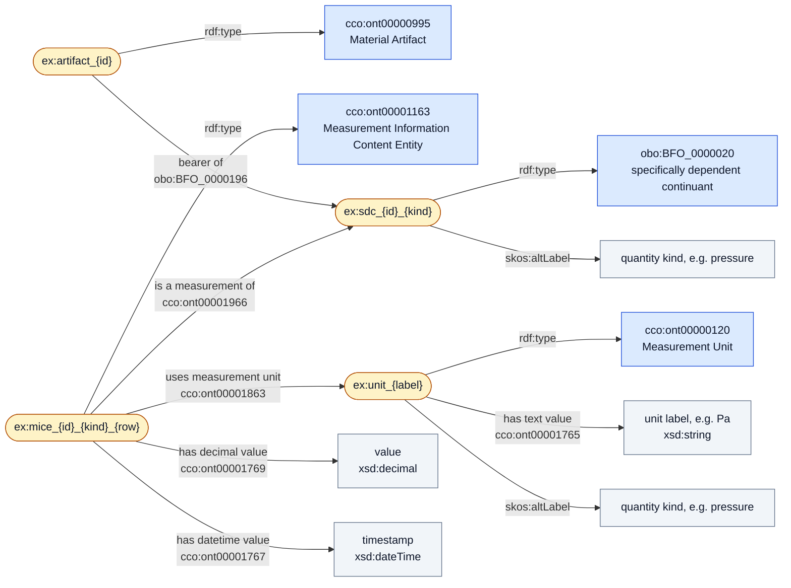

# Project 4: Measurement Graph (`src/measure_cco.ttl`)

`src/scripts/measure_rdflib.py` builds `src/measure_cco.ttl` from `src/data/readings_normalized.csv`. Each CSV row becomes one Measurement Information Content Entity (MICE), following the CCO Measurement Design Pattern in `src/cco_measurement_design_pattern.pptx`.

With sensors A, B, and C loaded, the graph has 9 artifacts, 11 SDCs, 15 MICE, 4 measurement units (K, Pa, V, ohm), and 129 triples.

## The pattern

Rounded nodes are instances, blue boxes are classes, and grey boxes are literals.

## Example: Boiler-07

This slice of the actual output omits `rdf:type` edges. Boiler-07 reports temperature in °F in sensor A and in °C in sensor B, and they can both get in the bin. We convert to K for value and they are mapped as SDCs.

```mermaid
flowchart LR
  A(["ex:artifact_Boiler-07"]):::inst

  ST(["ex:sdc_Boiler-07_temperature"]):::inst
  SP(["ex:sdc_Boiler-07_pressure"]):::inst

  M0(["ex:mice_Boiler-07_temperature_0"]):::inst
  M2(["ex:mice_Boiler-07_temperature_2"]):::inst
  M1(["ex:mice_Boiler-07_pressure_1"]):::inst
  M3(["ex:mice_Boiler-07_pressure_3"]):::inst

  UK(["ex:unit_K"]):::inst
  UP(["ex:unit_Pa"]):::inst

  V0["373.15 (from 212 °F)<br/>2024-03-17T19:03:00Z"]:::lit
  V2["373.15 (from 100 °C)<br/>2024-03-17T23:03:00Z"]:::lit
  V1["101352.93 (from 14.7 psi)<br/>2024-03-17T19:04:00Z"]:::lit
  V3["101325.0 (from 101.325 kPa)<br/>2024-03-17T23:04:00Z"]:::lit

  A -->|bearer of| ST
  A -->|bearer of| SP

  M0 -->|is a measurement of| ST
  M2 -->|is a measurement of| ST
  M1 -->|is a measurement of| SP
  M3 -->|is a measurement of| SP

  M0 -->|uses measurement unit| UK
  M2 -->|uses measurement unit| UK
  M1 -->|uses measurement unit| UP
  M3 -->|uses measurement unit| UP

  M0 -->|has value / datetime| V0
  M2 -->|has value / datetime| V2
  M1 -->|has value / datetime| V1
  M3 -->|has value / datetime| V3

  classDef inst fill:#fef3c7,stroke:#b45309,color:#0f172a
  classDef lit fill:#f1f5f9,stroke:#64748b,color:#0f172a
```

## Model notes

- ETL and JH4 both adhere to SI and we convert psi (× 6894.757) and kPa (× 1000) to Pa. Temperature is converted to kelvin (K = °C + 273.15; K = (°F − 32) × 5/9 + 273.15). V and ohm are acceptable.
- Chiller 3 and Chiller-3 are assumed to be discrete from ecah other, because i have 0 chill and this is where SME consultation is required. 
